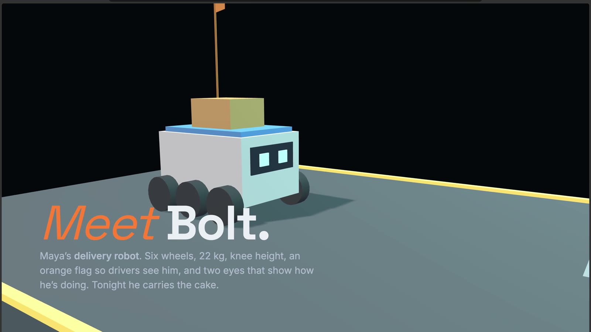
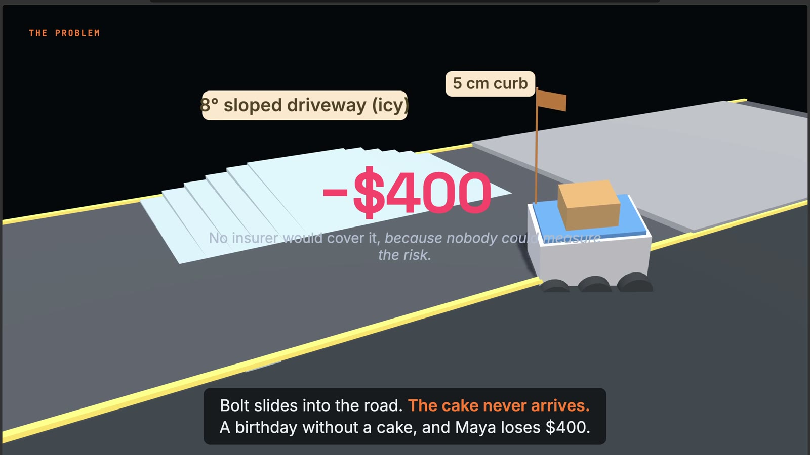
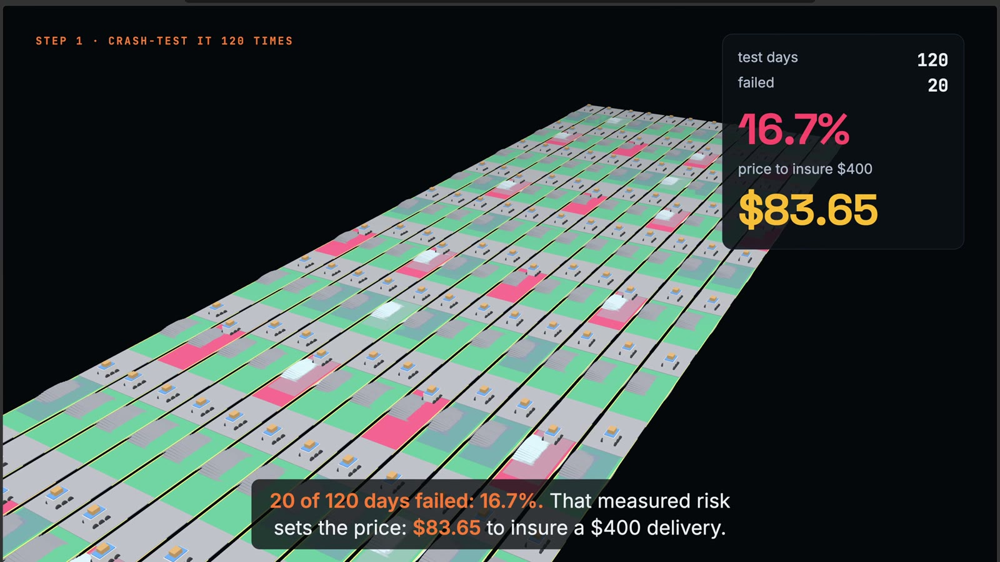
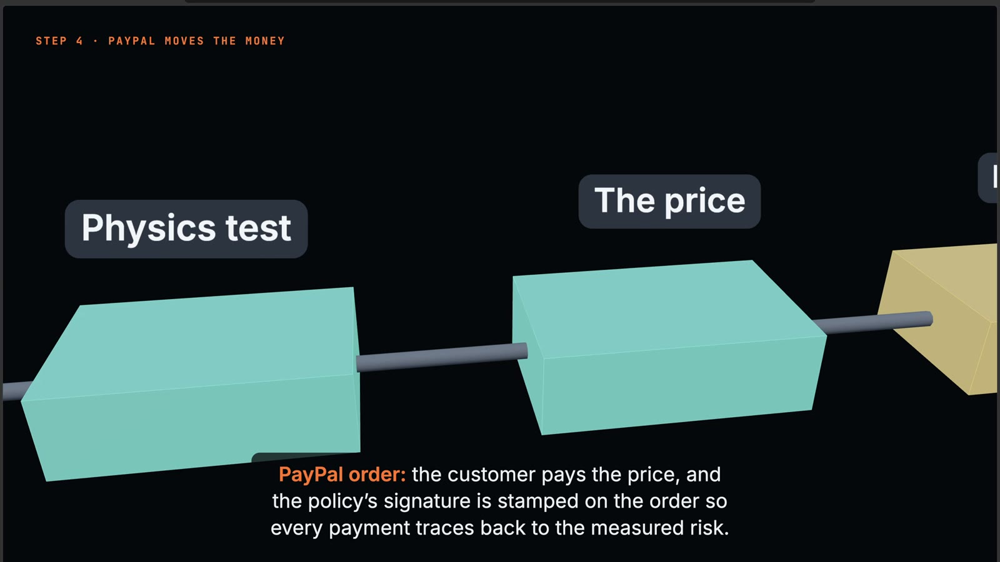
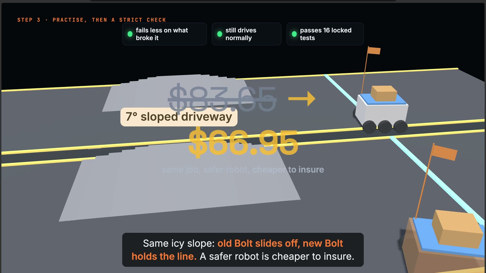
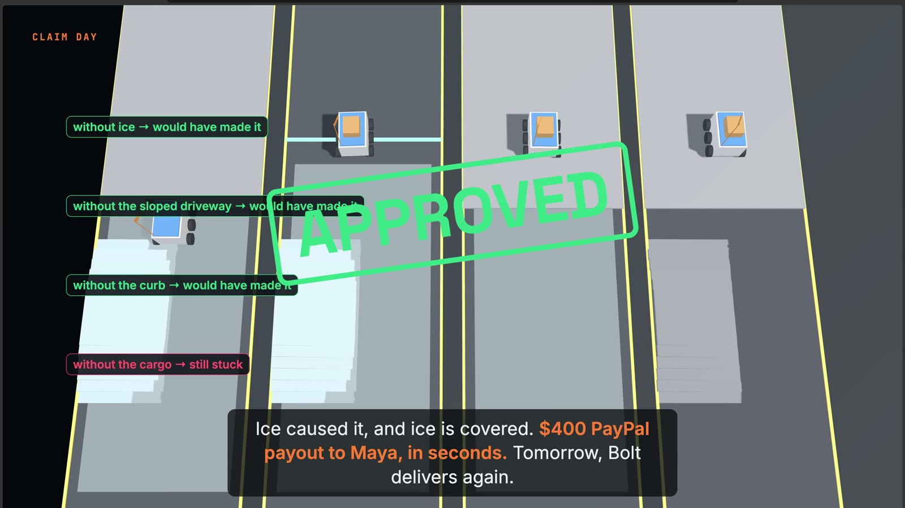

<div align="center">



# Hazard Pay

### Insurance for robot jobs, priced by trying to break the robot first.

**[▶ Watch the film (2:32)](https://youtu.be/dJF1CIuEYY8)** · **[Website](https://copyninja07-07.github.io/hazardpay/)** · **[Run it locally](#run-it)** · **[How it works](#how-it-works)**


</div>

---

## The problem

*8:47 pm, the first snow of the year. Maya's bakery has one delivery left: a birthday cake for a seven-year-old.
Her delivery robot, Bolt, slides on the icy driveway into the road. The cake never arrives.*

Robots now do paid work on real sidewalks, steps and factory floors, and they fail. When one fails mid-job, someone
loses money. But **nobody can insure a single robot job**, because nobody can say how risky *this robot, on this
route, tonight* really is. So the cover doesn't exist, and small businesses carry the whole loss.



## The idea

**Don't guess the risk. Measure it.** Before the job, Hazard Pay crash-tests the robot in a physics copy of that exact
route. How often it fails becomes the price, paid with **PayPal**. If it really fails on the day, the run is replayed to
find the cause, and a covered claim is paid with a **PayPal Payout** in seconds.

## How it works

| | Step | What happens |
|---|---|---|
|  | **1 · Rebuild the route** | A MuJoCo physics copy of the real route: the sloped driveway, the curb, the weather odds, the cargo. Describe a route or upload a photo and Gemini builds it. |
|  | **2 · Crash-test it 120 times** | Each run is a different day: dry, rain, ice, a stranger bumping into the robot. 20 of 120 fail → **16.7% risk → $83.65** to insure a $400 delivery. |
|  | **3 · An AI hunts for weak spots** | Gemini plays the adversary: it suggests how the robot fails, a search finds the worst realistic version, shrinks it to the smallest change that still breaks it, and re-checks it on 32 fresh runs. |
|  | **4 · Safer robot, lower price** | The robot practises on its failures and ships only after 3 strict checks (fails less, still drives normally, no worse on a locked 16-test suite). Same icy slope: old Bolt slides off, new Bolt holds the line. **$83.65 → $66.95.** |
|  | **5 · Claims by replay** | The exact run is replayed, removing one condition at a time. Covered cause (ice) → **PayPal Payout**. Excluded cause (14 kg overload) → denied. No paperwork. |

Every number comes from the simulator. Gemini suggests ideas and writes explanations; it never sets a price or decides a claim.

## PayPal integration

Every robot job becomes **two PayPal transactions**: the premium in, and the claim payout out.

```
premium   POST /v2/checkout/orders            intent = CAPTURE
            PayPal-Request-Id = policy hash    (idempotent)
            reference_id      = policy HMAC signature (every payment traces back to the measured risk)
          buyer approves in PayPal → POST /v2/checkout/orders/{id}/capture
claim     POST /v1/payments/payouts           sender_item_id = claim id
events    webhooks verified with verify-webhook-signature
```

Tested end to end on the PayPal sandbox: premium captured, claim approved, and a real **$400 sandbox payout** sent.

## Results

| | |
|---|---|
| Underwriting, "Maple St back door", robot v1 | 20 of 120 days failed: **16.7%** (95% CI 11–24%) → **$83.65** on $400 cover |
| After retraining + gate, robot v2 | **13.3%** → **$66.95** |
| A rejected update | beat its training failures but got worse on the locked suite, so the gate kept the old robot |
| AI adversary vs blind random attacks, same budget | **6 vs 2** confirmed failures |
| Claim, icy day | stuck 5.2 m in · delivers without the ice → **approved, $400 PayPal payout** |
| Claim, 14 kg cargo (limit 10 kg) | the overload caused it → **denied** |

## Run it

Needs Python 3.10–3.13 (MuJoCo wheels).

```bash
git clone https://github.com/CopyNinja07-07/hazardpay.git && cd hazardpay
python3.12 -m venv .venv && source .venv/bin/activate
pip install -r requirements.txt
uvicorn server:app --port 8000
```

- **App:** http://localhost:8000. It runs fully offline with no keys (built-in attack ideas + a fake PayPal); the header says which mode is on.
- **Watch it play itself:** http://localhost:8000/?tour=1
- **Website:** http://localhost:8000/home
- **Go live:** `cp .env.example .env`, then add `GEMINI_API_KEY`, `PAYPAL_CLIENT_ID`, `PAYPAL_CLIENT_SECRET` (a PayPal sandbox app, US business account for Payouts).

```bash
pytest -q                                   # 8 offline tests
python -m experiments.adversary_vs_random   # AI adversary vs random attacks
```

## Repository

```
hazardpay/        the engine
  world.py          MuJoCo model of the robot and the route
  sim.py            rollouts and the physical failure checks
  scenario.py       the hazard language (ice, curbs, slopes, bumps, cargo, motors, sensors)
  search.py         adversary search → shrink → confirm on fresh seeds
  attacker.py       Gemini hypotheses + photo/description → route
  underwrite.py     120-day Monte Carlo, price, risk per hazard, signed policy
  train.py          retraining + the 3-check gate and locked test suite
  claims.py         counterfactual replay and the claim decision
  paypal.py         Orders v2, capture, Payouts, webhook verification
server.py         FastAPI app
static/           web app (3D replay, AG Grid ledgers), auto-demo, website, 3D film
tests/            offline tests
experiments/      adversary vs random
tools/            film rendering (offline 3D), voice and score tools
docs/             film storyboard
media/            stills from the film
```

## Limits

- The robot is a simulated six-wheel sidewalk robot, not a specific commercial model. Calibrating against real fleet data is the next step.
- "Retraining" tunes a five-parameter driving controller, not a neural network.
- 120 days per quote gives about ±6 points of uncertainty; production would run thousands.
- PayPal runs on the sandbox.

---

<div align="center">

**Hazard Pay** · PayPal AI Hackathon 2026 · Suryansh Pratap Singh, Nikhil, Raj · MIT licence

</div>
